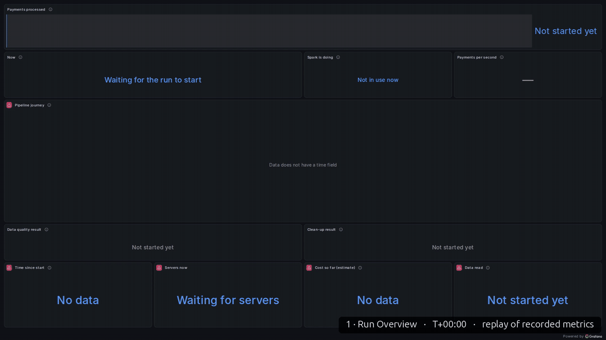
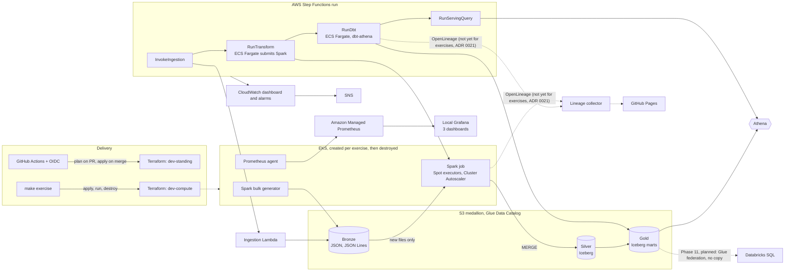

# Cerberus

*cerberus-platform*

[](https://github.com/ChiragVenkateshaiah/cerberus-platform/actions/workflows/terraform-plan.yml)
[](https://github.com/ChiragVenkateshaiah/cerberus-platform/actions/workflows/terraform-apply.yml)
[](https://github.com/ChiragVenkateshaiah/cerberus-platform/actions/workflows/code-ci.yml)
[](https://github.com/ChiragVenkateshaiah/cerberus-platform/actions/workflows/dbt-docs.yml)

**A production-style AWS lakehouse, built and operated as code by one engineer. Compute exists only while a run needs it.**



*The 100M take on dashboard 1 · Run Overview, replayed from the run's recorded metrics (2026-11-08): 100.0M events, 26 checks passed, cluster deleted, 65 min. This is a replay of recorded metrics, not a live screen capture.*

## At a glance

Cerberus moves synthetic payments data through an S3 medallion (bronze, silver, gold), with Spark on EKS, dbt and Athena, on Apache Iceberg. Step Functions orchestrates the runs, Terraform provisions everything, and CloudWatch, Prometheus and Grafana observe it. Every non-obvious choice is an [architecture decision record](docs/adr/) (25 so far), and each phase closes with a Well-Architected review.

## Headline result: 100 million events, from no compute back to no compute

On 2026-11-08 the platform processed 100 million new events in one orchestrated run. It built the compute layer from nothing, ran the pipeline, and deleted the compute layer again.

| Measure | Result |
|---|---|
| New events | 100,001,897 |
| Pipeline run | 859 s (14.3 min), about 116k events/s |
| Data quality | 26 checks passed, 0 errors, 1 known warning |
| Reconciliation | bronze = silver = 249,121,312 events |
| Whole exercise | 65 min: apply 790 s, generator 1,264 s, pipeline 870 s (harness clock), destroy 807 s |
| After destroy | EKS 0, NAT 0, EIP 0, running instances 0 |
| Spot executor nodes | 2 scaled to 4 during the transform (dashboard reading) |
| Cost | $2.20 estimated (servers $1.25, Athena $0.95), a dashboard estimate; the billed figure is posted later |

Sources: the [run record](observability/scale/runs/demo-100m-20261108T135119Z.json) and the [8.10 subsection of the scale metrics](docs/scale-metrics.md). The earlier 100M run (8.9) was billed: $0.37 for the run, 0.37 cents per million events, and $1.78 for the whole day (Cost Explorer, 2026-10-13).

## Architecture



A run is a Step Functions state machine with four states:

- **InvokeIngestion** calls the ingestion Lambda, which writes to bronze.
- **RunTransform** runs on ECS Fargate and submits the Spark job to EKS, which merges only the new bronze files into silver ([ADR 0019](docs/adr/0019-spark-submission-ecs-wrapper-vs-native-eks.md)).
- **RunDbt** runs `dbt build` on ECS Fargate through dbt-athena and builds the gold marts, with tests gating the build.
- **RunServingQuery** runs a demo Athena query against gold.
- The run then ends in Succeed or Fail.

Storage and incremental processing follow [ADR 0002](docs/adr/0002-medallion-layout.md) and [ADR 0017](docs/adr/0017-iceberg-incremental-processing.md). Spark runs on an On-Demand system node group and a Spot executor group ([ADR 0020](docs/adr/0020-dev-compute-node-autoscaling-and-spot.md)). Orchestration is [ADR 0009](docs/adr/0009-orchestration-step-functions-vs-airflow.md), and live observability is [ADR 0022](docs/adr/0022-live-observability-for-a-recorded-run.md).

## Tech stack

| Layer | Technology | ADR |
|---|---|---|
| Storage | S3, Apache Iceberg, Glue Data Catalog | [0002](docs/adr/0002-medallion-layout.md), [0017](docs/adr/0017-iceberg-incremental-processing.md) |
| Ingestion | Lambda, Spark bulk generator | [0005](docs/adr/0005-push-vs-pull-ingestion.md), [0018](docs/adr/0018-bulk-bronze-json-lines.md) |
| Compute | Spark on EKS, Spot, Cluster Autoscaler | [0007](docs/adr/0007-vpc-network-design.md), [0020](docs/adr/0020-dev-compute-node-autoscaling-and-spot.md) |
| Orchestration | Step Functions, ECS Fargate | [0009](docs/adr/0009-orchestration-step-functions-vs-airflow.md), [0019](docs/adr/0019-spark-submission-ecs-wrapper-vs-native-eks.md) |
| Transform and serving | dbt-athena, Athena | [0017](docs/adr/0017-iceberg-incremental-processing.md) |
| IaC and CI | Terraform (OpenTofu-swappable), GitHub Actions with OIDC | [0011](docs/adr/0011-ci-cd-github-actions-oidc.md) |
| Metrics | Prometheus agent, Amazon Managed Prometheus, Grafana | [0016](docs/adr/0016-prometheus-for-eks-spark.md), [0022](docs/adr/0022-live-observability-for-a-recorded-run.md) |
| Ops metrics | CloudWatch, SNS | [0014](docs/adr/0014-phase-6-well-architected-review.md) |
| Lineage | OpenLineage, serverless collector | [0013](docs/adr/0013-lineage-openlineage-serverless-collector.md) |

## Scale ladder

Each step is one orchestrated run. The records are in `observability/scale/runs/`, and [docs/scale-metrics.md](docs/scale-metrics.md) explains every number. The [8.10 results section](docs/scale-metrics.md#results-1m-10m-and-100m-810) puts the 1M, 10M and 100M (8.9) runs side by side, with charts of run time, cost per million events and transform throughput.

| Step | New events | Silver after | Run (s) | Data quality | $/M events (run) |
|---|---|---|---|---|---|
| Baseline | 39,222 | 39,222 | 363.4 | suite not built yet | 1.0699 |
| 10M | 9,005,590 | 10,081,387 | 522.8 | passed | 0.0112 |
| 100M (8.9) | 100,008,511 | 137,113,940 | 742.0 | passed | 0.0037 |
| 1M (clean, 8.10) | 1,005,920 | 138,119,860 | 581.2 | passed | 0.2928 |
| 100M take (8.10) | 100,001,897 | 249,121,312 | 859.1 | passed | not posted yet |

The clean 1M run costs more per event than the 100M runs for two reasons. Each run pays a fixed overhead, and this run happened on top of 138M silver events.

- **SLO headroom:** the 8.9 run took 742 s against the 30-minute run-latency SLO, 2.4 times headroom. The take, at 859 s, is 48% of the limit, about 2.1 times headroom (computed from the run record).
- **Spot interruption:** an AWS FIS interruption in the middle of a 9M-event run caused no failure, and silver matched bronze at 37,105,429 events (8.8).
- **Full audit:** the milestone `--full` audit re-checked every bronze key against silver: 137,113,940 = 137,113,940.

## Observability for everyone

Three Grafana dashboards tell the story of a run at three levels:

1. **1 · Run Overview: progress, quality, cost.** For anyone, including finance and product: is the run progressing, did it pass, what did it cost.
2. **2 · Run Health: compute and throughput.** For engineering and operations: nodes, executors and throughput.
3. **3 · Spark and Cluster Diagnostics.** For platform and Spark engineers.

Grafana runs locally in Docker Compose against Amazon Managed Prometheus, so no standing server exists ([ADR 0022](docs/adr/0022-live-observability-for-a-recorded-run.md)). A CloudWatch dashboard and alarms feed an SNS topic (most alarms arm only for scheduled runs; ADR 0021 adds exercise alerting in Phase 10), and [six SLOs](docs/slo.md) define the reliability targets. Lineage is collected for scheduled runs; exercise lineage is planned (ADR 0021). It is documented in [docs/lineage.md](docs/lineage.md), with a [dbt model DAG](https://chiragvenkateshaiah.github.io/cerberus-platform/dbt/) and a [runtime lineage graph](https://chiragvenkateshaiah.github.io/cerberus-platform/lineage/) on GitHub Pages.

## Data quality and reliability

- A 26-check suite reconciles bronze, silver and gold on every exercise (`observability/scale/data_quality.py`).
- dbt tests gate `dbt build`, so bad data fails the run instead of landing silently.
- Every exercise tears down from an EXIT trap (`orchestration/exercise.sh`), so a failed run does not leave billable resources behind.

## Cost and security

- The budget is $20 a month, with alerts at $15 and $20.
- Between runs nothing billed by the hour exists. The standing layer is pay-per-request services plus S3 storage.
- CI has no long-lived keys: GitHub Actions authenticates through OIDC ([ADR 0011](docs/adr/0011-ci-cd-github-actions-oidc.md)), and it applies only the standing layer.
- The admin user runs on least-privilege policies instead of AdministratorAccess: six built from its CloudTrail history, plus two added for the demo console ([iam/cerberus-admin/](iam/cerberus-admin/)).
- The Well-Architected review for Phase 8 cut HIGH risks from 23 to 18 ([ADR 0023](docs/adr/0023-phase-8-well-architected-review.md)).
- The whole build had cost $5.74 gross through 2026-10-02, all covered by credits ([cost and security summary](docs/cost-security-summary.md); a dated figure).

## Where Databricks fits

Databricks is a complement, not a replacement. In Phase 11 (planned), Databricks SQL reads Cerberus's Iceberg gold tables through Unity Catalog's AWS Glue federation, with no copy, managed in Terraform. The same workload is then measured on both engines. Cerberus stays the system of record and the only writer (see "Not a migration" in [docs/plan.md](docs/plan.md)).

## Roadmap

| Phase | Theme | Status | Key ADRs |
|---|---|---|---|
| 0 | Foundation, built by hand | Done | [0001](docs/adr/0001-record-architecture-decisions.md) |
| 1 | MVP: end-to-end lakehouse | Done | [0002](docs/adr/0002-medallion-layout.md), [0003](docs/adr/0003-synthetic-payments-data-model.md) |
| 2 | Event-driven ingestion | Done | [0005](docs/adr/0005-push-vs-pull-ingestion.md) |
| 3 | Scalable compute | Done | [0007](docs/adr/0007-vpc-network-design.md) |
| 4 | Orchestration | Done | [0009](docs/adr/0009-orchestration-step-functions-vs-airflow.md) |
| 5 | CI/CD | Done | [0011](docs/adr/0011-ci-cd-github-actions-oidc.md) |
| 6 | Observability and data quality | Done | [0013](docs/adr/0013-lineage-openlineage-serverless-collector.md) |
| 7 | End-to-end validation | Done | [0015](docs/adr/0015-phase-7-well-architected-review.md), [0016](docs/adr/0016-prometheus-for-eks-spark.md) |
| 8 | Scale validation | In progress: results write-up, demo video, Well-Architected milestone | [0017](docs/adr/0017-iceberg-incremental-processing.md)-[0020](docs/adr/0020-dev-compute-node-autoscaling-and-spot.md), [0022](docs/adr/0022-live-observability-for-a-recorded-run.md), [0023](docs/adr/0023-phase-8-well-architected-review.md) |
| 9 | Demo console | In progress: design accepted (ADR 0024), prerequisites built | [0024](docs/adr/0024-demo-console.md) |
| 10 | Pipeline status and alerting | Planned: design accepted | [0021](docs/adr/0021-pipeline-status-and-alerting.md) |
| 11 | Databricks interoperability | Planned | none yet |
| 12 | Platform tooling in Go | Planned | none yet |
| 13 | Streaming ingestion | Planned | none yet |
| 14 | AI operations agents | Planned: ADR 0025 accepted 2026-11-08 | [0025](docs/adr/0025-ai-operations-agents.md) |

Subtask-level progress is in [Phases.md](Phases.md), and the full plan is in [docs/plan.md](docs/plan.md).

## Run it yourself

Prerequisites: an AWS account, Terraform or OpenTofu, the AWS CLI with a `cerberus-admin` profile, Docker, and uv. The Terraform state bucket name in `terraform/envs/*/versions.tf` is account-specific, so a fork must change it first.

`make exercise` creates billable resources (EKS, NAT, Spot nodes) and destroys them when it exits.

```bash
make help
make bootstrap-init && make bootstrap-apply
make standing-init && make standing-plan
make exercise-check
make exercise ARGS="--yes --generate 1000000"
make grafana-up
make compute-destroy   # failure path only
```

Set `TF_BIN=tofu` to use OpenTofu instead of Terraform.

## Repository layout

```
terraform/       bootstrap (state backend), modules, envs/dev-standing (CI-managed),
                 envs/dev-compute (human-run, per exercise)
ingestion/       synthetic payments generator and the ingestion Lambda
transform/       Spark bronze-to-silver job, bulk generator, dbt project
orchestration/   state machine definition, ECS runner image, exercise.sh
observability/   Grafana dashboards, scale harness and run records, freshness probe
lineage/         OpenLineage collector and the Pages graph renderer
serving/         demo Athena queries against gold
iam/             cerberus-admin least-privilege policies
docs/            plan, ADRs, SLOs, scale metrics, runbooks
articles/        weekly engineering write-ups
```

## Documentation

- [docs/plan.md](docs/plan.md): the build plan and phased roadmap
- [Phases.md](Phases.md): subtask-level progress
- [docs/adr/](docs/adr/): architecture decision records
- [docs/scale-metrics.md](docs/scale-metrics.md): the Phase 8 metric set, cost method and results at each scale step
- [docs/slo.md](docs/slo.md): service level objectives and error-budget policy
- [docs/lineage.md](docs/lineage.md): data lineage at table and column granularity
- [docs/cost-security-summary.md](docs/cost-security-summary.md): what the build cost, how every caller authenticates, and the accepted residual risks
- [docs/demo-recording.md](docs/demo-recording.md): the runbook for recording the 100M take
- [docs/architecture.md](docs/architecture.md): Phase 1 MVP architecture write-up
- [articles/README.md](articles/README.md): index of the published articles

## License

[MIT](LICENSE)
